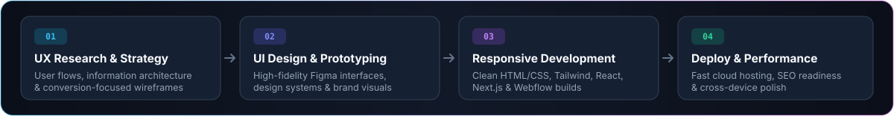

  

 

  &nbsp;
  &nbsp;
  &nbsp;
  

---

### 👨‍💻 About Me

<table>
<tr>
<td width="58%" valign="center">

I'm **Shashika Malshan**, a **Creative Web Designer, UI/UX Specialist, and Frontend Developer** dedicated to crafting sleek, intuitive, and conversion-driven digital experiences. I bridge the gap between aesthetic visual storytelling and clean, scalable engineering.

- 🎨 **UI/UX & Visual Design:** Designing modern web interfaces, interactive **Figma** prototypes, design systems & brand visuals
- 💻 **Frontend Craftsmanship:** Building fast, mobile-first, pixel-perfect websites with **HTML5, CSS3, Tailwind CSS, JavaScript, React & Next.js**
- 🧠 **Technical Foundation:** Combining creative design sensibility with **Networking, Systems & ICT** expertise (*BSc in ICT at SLIIT*)
- 🚀 **Available For:** Freelance web design, UI/UX redesigns, landing pages & modern frontend builds
- 📫 **Direct Email:** [nakshanshashu@gmail.com](mailto:nakshanshashu@gmail.com)

</td>
<td width="42%" align="center" valign="center">
  
</td>
</tr>
</table>

---

### ✨ What I Do

<table>
<tr>
<td width="33%" valign="top">

#### 🎨 UI/UX & Product Design
Wireframing, user flows, design tokens, and high-fidelity interactive **Figma** prototypes tailored for usability, clarity, and modern aesthetics.

</td>
<td width="33%" valign="top">

#### 🌐 Modern Web Design & Dev
Responsive business websites, SaaS landing pages, portfolios, and custom web experiences built with clean frontend code, **Webflow**, or **WordPress**.

</td>
<td width="33%" valign="top">

#### 🎯 Brand & Graphic Identity
Cohesive visual identities, digital graphics, UI iconography, social visuals, and motion assets that make digital products stand out.

</td>
</tr>
</table>

  

---

### 🛠️ Languages, Design & Tech Stack

<h4 align="center">🎨 UI/UX, Graphic &amp; Web Design Tools</h4>

  &nbsp;
  &nbsp;
  &nbsp;
  &nbsp;
  &nbsp;
  &nbsp;
  &nbsp;
  

<h4 align="center">🌐 Frontend &amp; Modern Web Technologies</h4>

  &nbsp;
  &nbsp;
  &nbsp;
  &nbsp;
  &nbsp;
  &nbsp;
  &nbsp;
  &nbsp;
  &nbsp;
  

<h4 align="center">⚙️ Programming, Backend &amp; Databases</h4>

  &nbsp;
  &nbsp;
  &nbsp;
  &nbsp;
  &nbsp;
  &nbsp;
  &nbsp;
  &nbsp;
  

<h4 align="center">🚀 Workflow, Cloud Hosting &amp; Systems</h4>

  &nbsp;
  &nbsp;
  &nbsp;
  &nbsp;
  &nbsp;
  &nbsp;
  &nbsp;
  &nbsp;
  &nbsp;
  

---

  <h3>🤝 Let's Build Something Exceptional Together</h3>
  
Have a website, UI/UX project, or creative idea in mind? Feel free to reach out!

  

    &nbsp;&nbsp;&nbsp;
    &nbsp;&nbsp;&nbsp;
    
  

